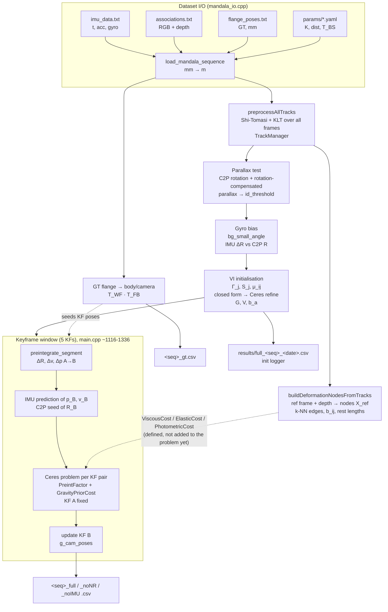

# DefVINS — Architecture

This document describes the C++ implementation as it is in this repository
(`src/`, `include/`, `scripts/`). It describes **what the code does today**,
which in a few places differs from the method in the paper; those differences
are listed in [Possible issues](#possible-issues). Line numbers refer to the
commit this file was added in.

- [1. Overview](#1-overview)
- [2. Build and dependencies](#2-build-and-dependencies)
- [3. Modules](#3-modules)
- [4. Pipeline](#4-pipeline)
- [5. Per-frame / per-keyframe data flow](#5-per-frame--per-keyframe-data-flow)
- [6. IMU preintegration](#6-imu-preintegration)
- [7. Inertial residuals and the optimisation](#7-inertial-residuals-and-the-optimisation)
- [8. Deformation graph](#8-deformation-graph)
- [9. Configuration modes](#9-configuration-modes)
- [10. Input data layout](#10-input-data-layout)
- [11. Output files](#11-output-files)
- [12. Frames, units and conventions](#12-frames-units-and-conventions)
- [Possible issues](#possible-issues)

---

## 1. Overview

DefVINS is a visual–inertial odometry system for deformable scenes. It splits
the state into:

- a **rigid, IMU-anchored state** per keyframe (orientation, position,
  velocity) plus global gravity and IMU biases, and
- a **non-rigid deformation model**: an embedded deformation graph whose nodes
  are 3-D points back-projected from long feature tracks, with viscous,
  elastic and photometric terms.

The executable is a single offline program, `defvins`, which processes one
recorded sequence (Mandala layout, see §10) and writes trajectory CSVs.

```
defvins <sequence_path> [mode_full | mode_no_nr | mode_no_imu]
```

Main control flow is in `src/main.cpp::main()`; the remaining files are
helpers.

## 2. Build and dependencies

| Dependency | Used for | Version in the Docker image |
|---|---|---|
| Eigen 3 | all linear algebra | 3.4.0 (apt) |
| OpenCV 4 (core, imgproc, imgcodecs, video, calib3d, highgui) | KLT tracking, `goodFeaturesToTrack`, `findEssentialMat`, `undistortPoints`, image I/O | 4.5.4 (apt) |
| yaml-cpp | calibration YAMLs | 0.7.0 (apt) |
| Ceres Solver **≥ 2.1** | all non-linear optimisation (`ceres::Manifold` is used) | 2.2.0 (source) |
| Pangolin | 3-D viewer (`defgraph_3d_viewer.cpp`, linked but not called by `main`) | v0.9.1 (source) |
| Python 3 + pybind11 (embed) | calls the C2P relative-rotation solver | Python 3.10, pybind11 2.9.1 |
| `nonmin-pose` (PyPI) + numpy | C2P certifiable relative-pose solver (`scripts/nonmin_pose_wrapper.py`) | 0.0.1, numpy 1.26.4 |

g2o is **not** used: every optimisation is done with Ceres.

Reproducible build: `docker/Dockerfile` (Ubuntu 22.04). See
[`docker/README.md`](docker/README.md).

Sources compiled into `defvins` (from `CMakeLists.txt`): `main`,
`ceres_refine`, `bg_small_angle`, `bg_optimization`, `mandala_io`,
`c2p_wrapper`, `camera_utils`, `feature_tracking`, `frame_processor`,
`feature_tracker`, `track_manager`, `visualize_tracking`, `utils`, `viewer`,
`defgraph_3d_viewer`, `vins_closed_form`, `deformation_graph`,
`alignment_utils`.

Not compiled (legacy / unused): `src/euroc_io.cpp`, `src/imu_preint.cpp`,
`src/sliding_window.cpp`. `include/euroc_io.h` and `include/sliding_window.h`
are still included for their declarations/types only.

## 3. Modules

| Module | Files | Responsibility |
|---|---|---|
| **Dataset I/O** | `mandala_io.{h,cpp}` | Loads IMU (`imu_data.txt`), RGB/depth associations (`associations.txt`), robot flange ground truth (`flange_poses.txt`) and the extrinsics `T_BS` of camera, IMU and flange from `params/*.yaml`. Converts mm → m. |
| (legacy) EuRoC I/O | `euroc_io.{h,cpp}` | EuRoC loader; not compiled anymore. |
| **Calibration** | `camera_utils.{h,cpp}` | Reads `intrinsics`, `distortion_coefficients`, `resolution` from `params/camera.yaml` into `K`. |
| **Pose helpers** | `alignment_utils.{h,cpp}`, `lie_utils.h`, `utils.{h,cpp}` | Homogeneous transforms, `Exp`/`Log` on SO(3) (double and templated for Jets), RMSE helpers, median, path helpers for results. |
| **Feature tracking** | `feature_tracker.{h,cpp}`, `track_manager.{h,cpp}`, `point_track.h` | Shi–Tomasi + pyramidal KLT over the whole sequence; keeps persistent track IDs (`TrackManager::tracks`). |
| **Two-view tracking** | `feature_tracking.{h,cpp}` | Detect + KLT between two arbitrary images (used before C2P). |
| **Relative rotation (C2P)** | `c2p_wrapper.{h,cpp}`, `scripts/nonmin_pose_wrapper.py`, `utils.cpp::compute_Rij_with_c2p` | Undistorts points, RANSAC essential matrix for inlier selection, then calls the certifiably-optimal C2P solver (`nonmin_pose.C2PFast`) through embedded Python. Returns `R01`. |
| **Gyro bias** | `bg_small_angle.{h,cpp}`, `bg_optimization.{h,cpp}` | Closed-form small-angle gyro-bias estimate from IMU-integrated vs. C2P rotation (`bg_small_angle` is the one used); Ceres variant kept for experiments. |
| **VI initialisation** | `vins_closed_form.{h,cpp}`, `ceres_refine.{h,cpp}`, `compute_mu_from_uv.h` | Martinelli-style closed-form solve of gravity `G`, velocity `V`, accelerometer bias `B` and point depths `λ`, then Ceres refinement with a gravity-norm prior. |
| **IMU preintegration** | `main.cpp::preintegrate_segment`, `imu_preint.h` (`ImuSample`, `PreintMeas`) | ΔR, Δv, Δp between consecutive keyframes. |
| **Factors** | `factors.h` | `PreintFactor` (9-D inertial residual), `GravityPriorCost`, `PriorFactor`, `ReprojectionCost`. |
| **Sliding window types** | `sliding_window.h` | `KFState`, `GlobalParams`; the `WindowManager` class itself is not used by `main`. |
| **Deformation graph** | `deformation_graph.{h,cpp}` | Builds nodes from tracks + depth, k-NN graph with viscous weights and rest lengths; Ceres cost functors `ViscousCost`, `ElasticCost`, `PhotometricCost`; drawing / video export. |
| **Viewers** | `viewer.{h,cpp}` (OpenCV), `defgraph_3d_viewer.{h,cpp}` (Pangolin), `visualize_tracking.{h,cpp}` | Interactive visualisation. None of them is called from `main()`, so the binary runs headless. |
| (legacy) | `frame_processor.{h,cpp}` | Earlier per-pair bias experiment (`process_frame_pair`); compiled, not called. |

## 4. Pipeline



## 5. Per-frame / per-keyframe data flow

The program is offline and works in batch stages rather than one frame at a
time.

1. **Load** (`main.cpp:461`). All IMU samples, image/depth paths, GT and
   extrinsics are loaded into memory. GT flange poses are converted to
   body/camera poses with `T_WB = T_WF · T_FB` (`main.cpp:477-478`, via
   `transformPositionsRight` / `transformQuaternionsRight`).
2. **Tracking over the whole sequence** (`preprocessAllTracks`,
   `main.cpp:517`). For every image *i*, `FeatureTracker::processFrame`:
   - first frame: up to 100 Shi–Tomasi corners (min distance 40 px), one new
     track each;
   - next frames: pyramidal KLT from the previous image, observation appended
     to the same track ID; if fewer than 80 survive, up to 10 new corners are
     added.
   All observations are stored as `(frame_idx, uv)` in `TrackManager`.
3. **Deformation graph at the reference frame** (`main.cpp:529`, only
   `ref_frame_idx = 1` is processed). See §8.
4. **Translation / parallax trigger** (`main.cpp:558-630`). For
   `k = ref+1 … ref+21`:
   - `compute_Rij_with_c2p(ref, k+1)` → KLT + undistortion + RANSAC
     essential matrix (inliers) + **C2P** (Python) → `R_k_k1`;
   - parallax after rotation compensation with `H = K Rᵀ K⁻¹`
     (`compute_translation_parallax_score`) and with `H = K R K⁻¹`
     (`rotCompParallaxMedianPx`);
   - stop when an absolute (≥ 6 px), windowed (3 of 6 ≥ 4 px) or relative
     (≥ 25 %) criterion holds and the rotation-compensated parallax is
     ≥ 1.2 px. The number of frames used is `id_threshold`.
5. **Gyroscope bias** (`estimate_bg_once`, `main.cpp:634-679`). IMU samples
   between frames `ref` and `ref+1` are integrated to `R_preint`; C2P gives
   `R_ij`; `bg_small_angle` returns
   `b_g = −Log(R_imuᵀ·R_preint·R_imu)ᵀ·(R_cam R_ij R_camᵀ)) / (n·Δt)`.
6. **Visual–inertial initialisation** (`main.cpp:730-1051`), using
   `n_frames = id_threshold` frames after `ref` and up to `N = 7` tracks:
   - for every frame *j*: `R_ij`, `Γ_j = Σ (t_j − τ_k) R_ik Δt`,
     `S_j = Σ (t_j − τ_k) R_ik a_k Δt`, `t_j`;
   - bearings `μ_ij = R_ij · μ(uv)` for each track *i* in frame *j*;
   - only frames ("columns") and points that are complete are kept and
     re-indexed;
   - `solveVINSWithBias` (closed form, SVD) gives a warm start, rescaled so
     that `|G| = 9.81`; `defvins::SolveWithCeres` refines it (§7.3);
   - the resulting gravity is rotated to the world frame with the GT
     orientation of the reference frame: `g_W = R0_gt · G`
     (`main.cpp:1018`). RMSE against GT is printed.
7. **Keyframe window** (`main.cpp:1116-1336`). Every frame from
   `first_kf = id_threshold + 1` is a keyframe. KFs are pushed into a deque;
   when it holds 5 KFs, each consecutive pair (A, B) is optimised (§7.2), B is
   updated, all 5 KFs are written to the estimate CSV and the deque is
   cleared.

## 6. IMU preintegration

Two implementations exist; only the first one is used.

### 6.1 `preintegrate_segment` (`main.cpp:171-210`, used)

For the IMU samples with `t_A ≤ t_k`, `t_{k+1} ≤ t_B`:

```
ω = ω_k − b_g          a = a_k − b_a           (specific force, gravity NOT removed)
a_w   = R · a                                   (R = ΔR accumulated so far, frame of KF A)
α    += β Δt + ½ a_w Δt²                        (Δp)
β    += a_w Δt                                  (Δv)
R     = R · Exp(ω Δt)                           (ΔR)
```

Output `PreintMeas{dR, dv, dp, dt = t_B − t_A}`. Gravity is not included, so
the residuals add it explicitly. There is no noise propagation (no covariance,
no bias Jacobians): when biases change, the segment is not re-linearised; it is
simply recomputed the next time with the current `gp.bg`, `gp.ba`. The bias
values themselves are not optimised in the window.

### 6.2 `Preintegrate` (`src/imu_preint.cpp`, not compiled)

An older variant that adds gravity inside the integration (`v += (R a + g)Δt`).
Kept for reference.

### 6.3 Initialisation integrals (`main.cpp:782-795`)

For the closed-form initialisation the IMU segment from the reference frame to
frame *j* is reduced to

```
R_ij  = Π Exp((ω_k − b_g) Δt)
Γ_j   = Σ_k (t_j − τ_k) R_ik Δt          (3×3, multiplies the accelerometer bias)
S_j   = Σ_k (t_j − τ_k) R_ik a_k Δt      (3×1, double integral of specific force)
```

## 7. Inertial residuals and the optimisation

### 7.1 `PreintFactor` (`include/factors.h:6-87`)

Parameter blocks: `q_i (4), p_i (3), v_i (3), q_j (4), p_j (3), v_j (3), g (3)`.
Quaternions are Eigen-ordered `(x, y, z, w)` (`Eigen::Map<Quaternion<T>>`).

```
r_p = R_iᵀ (p_j − p_i − v_i Δt − ½ g Δt²) − Δp
r_v = R_iᵀ (v_j − v_i − g Δt)            − Δv
r_R = vee(E − Eᵀ)/2,   E = ΔRᵀ R_iᵀ R_j  (≈ Log(E) for small errors)
residual = [r_p; r_v; r_R]  (9×1, unweighted)
```

`g` is the gravity **vector** in world coordinates (e.g. `(0, 0, −9.81)` for a
Z-up world), estimated as a parameter. The constructor argument `g` is stored
but not used.

### 7.2 Keyframe-pair problem (`main.cpp:1175-1322`)

For each consecutive pair (A, B) inside the 5-KF window:

1. **Seeds**
   - `p_B = p_A + v_A Δt + ½ g Δt² + R_A Δp`, `v_B = v_A + g Δt + R_A Δv`
     (IMU prediction; not in `mode_no_imu`);
   - `R_B = R_A · R_c2p(A→B)` if C2P succeeds, otherwise `R_A · ΔR`.
2. **Parameter blocks**: `q_A, q_B` (quaternion manifold), `p_A, p_B, v_A,
   v_B`; KF A is held **constant** (gauge anchor).
3. **Residual blocks** (only when the mode uses the IMU):
   - `GravityPriorCost`: `10 · (g − g_init)` (3-D), no loss;
   - `PreintFactor` with `HuberLoss(1.0)`.
4. **Solver**: `SPARSE_NORMAL_CHOLESKY`, 20 iterations.
5. **Update**: B ← solution; `g_cam_poses[B.k] = {R_B, p_B}`. Because B is
   A of the next pair, the solution propagates along the window.

The `ReprojectionCost` (`factors.h:127-182`, pinhole projection of a world
point through `T_WB` and `T_BC`) and the deformation costs (§8) are defined
but not added to this problem in the current `main()`.

### 7.3 Initialisation problem (`ceres_refine.cpp`)

Unknowns: `G (3)`, `V (3)`, `B (3)` and one depth `λ_ij` per point and frame.

- `EqJ_FirstPointResidual` (for the reference point *i₀* and every frame *j*):
  `−½ t_j² G − t_j V + Γ_j B + λ₀₀ μ₀₀ − λ₀ⱼ μ₀ⱼ − S_j` (Huber 1.0);
- `EqIJ_CouplingResidual` (other points *i*):
  `λ₀₀ μ₀₀ − λ₀ⱼ μ₀ⱼ − λᵢ₀ μᵢ₀ + λᵢⱼ μᵢⱼ` (Huber 1.0);
- `GravityNormPenalty`: `|G| − 9.81`;
- `BiasL2Penalty`: `B / 0.5`.

Solver: `SPARSE_SCHUR` with explicit Schur complement, 50 iterations.
`solveVINSWithBias` (`vins_closed_form.cpp`) solves the same linear system
(without the penalties) by SVD and normalises `|G|` to 9.81.

## 8. Deformation graph

Built once at the reference frame by `buildDeformationNodesFromTracks`
(`deformation_graph.cpp:204-342`):

- **Nodes**: one per track that is observed in the reference frame and has a
  valid depth. Depth is read from the 16-bit (or float) depth image at the
  rounded pixel and multiplied by `depth_scale = 0.001` (mm → m). The rest
  position is in the **reference camera frame**: `X_ref = K⁻¹ [u v 1]ᵀ · d`.
  The node ID is the track ID.
- **Edges**: for every node, up to `K_neigh = 6` nearest neighbours inside
  `max_radius = 0.2 m`. Duplicates are removed (`i < j`).
- **Weights**: viscous weight `b_ij = exp(−d² / (2σ²))`, `σ = 0.05 m`; rest
  length `d0_ij = d` stored in `g_rest_length`.
- **Global state**: `g_nodes_rest`, `g_viscous_edges`, `g_rest_length`,
  `g_nodes_per_kf` (node positions per KF), `g_cam_poses` (KF poses).

Cost functors (`deformation_graph.h`), all autodiff:

| Cost | Parameters | Residual |
|---|---|---|
| `ViscousCost(b_ij)` | `X_i^t, X_i^{t−1}, X_j^t, X_j^{t−1}` | `√b_ij · ((X_i^t − X_i^{t−1}) − (X_j^t − X_j^{t−1}))` (3) |
| `ElasticCost(d0, k)` | `X_i^t, X_j^t` | `√k · (‖X_i − X_j‖ − d0) / √d0` (1) |
| `PhotometricCost(I_A, I_B, uv_A, K)` | `X_B` (node in camera B) | 3×3 patch: `I_B(π(X_B) + δ) − I_A(uv_A + δ)` (9), bilinear interpolation |

`main()` declares `sigma = 0.02`, `d_max = 5`, `b_ij`, `k_elas = 1.0`
(`main.cpp:445-448`) for these terms, but the terms are not added to any
`ceres::Problem` yet (see Possible issues). Visualisation helpers:
`drawDeformationGraphOnFrame`, `drawRestAndOptimizedGraph`,
`exportDeformationVideo`, the OpenCV `runTrackViewer` and the Pangolin
`runDeformationGraph3D`.

## 9. Configuration modes

`enum class ConfigMode` (`main.cpp:76-80`), chosen by the 2nd command-line
argument (`parseConfigMode`, `main.cpp:84-116`). Missing or unknown values
fall back to FULL.

| CLI argument | Enum | Intended meaning | What the current code does | Output file |
|---|---|---|---|---|
| `mode_full` | `DEFVINS_FULL` | IMU + non-rigid (deformation graph) terms | IMU seed + `PreintFactor` + gravity prior in each KF-pair problem | `<seq>_full.csv` |
| `mode_no_nr` | `DEFVINS_NO_NR` | Ablation: drop non-rigid terms (rigid VIO) | **Same code path as FULL** (no branch checks `DEFVINS_NO_NR`; non-rigid terms are not active in FULL either) | `<seq>_noNR.csv` |
| `mode_no_imu` | `DEFVINS_NO_IMU` | Ablation: drop inertial terms (visual + non-rigid only) | Each KF position is replaced by Gaussian noise N(0, 0.5 m) (`main.cpp:1162-1166`); no IMU seed, no `PreintFactor` / gravity prior. The problem then has no residuals, so B keeps its seed (rotation from C2P) | `<seq>_noIMU.csv` |

## 10. Input data layout

`load_mandala_sequence(<seq>)` expects:

```
<seq>/
├── imu_data.txt        header + rows "t ax ay az gx gy gz"   (whitespace separated)
├── associations.txt    header + rows "t_rgb rgb_path t_depth depth_path"  (paths relative to <seq>)
├── flange_poses.txt    header + rows "t qx qy qz qw x y z"   (positions in mm)
└── params/
    ├── camera.yaml     T_BS (4×4, translation in mm), intrinsics [fx fy cx cy],
    │                   distortion_coefficients, resolution
    ├── imu.yaml        T_BS (translation in mm)
    └── flange.yaml     T_BS (translation in mm) = T_flange_body
```

Timestamps are used as given (no `1e-9` scaling for Mandala); they must be in
seconds and share the same clock.

## 11. Output files

All three are plain CSV with a header row.

### 11.1 Estimated trajectory — `<seq>_full.csv`, `<seq>_noNR.csv`, `<seq>_noIMU.csv`

Written to the **current working directory** (`main.cpp:1093`, rows at
`main.cpp:1325-1332`). One row per keyframe, emitted in blocks of 5 (one per
window).

| Column | Meaning |
|---|---|
| `timestamp` | camera timestamp `tcam[k]` [s] (18 significant digits) |
| `px, py, pz` | KF position in the world (GT) frame [m] |
| `qx, qy, qz, qw` | KF orientation `R_W·` as a unit quaternion, Hamilton, scalar last |

TUM-like but comma separated; e.g. for `evo`:
`evo_ape tum <(tail -n +2 seq_gt.csv | tr , ' ') <(tail -n +2 seq_full.csv | tr , ' ') -a`.

### 11.2 Ground truth — `<seq>_gt.csv`

Same columns and conventions as 11.1, one row per GT sample, written once
(`main.cpp:1100-1109`): flange GT transformed with `T_flange_body` (`p` in m).

### 11.3 Initialisation log — `results/full_<seq>_<YYYYMMDD_HHMMSS>.csv`

Created by `CsvLogger` in `<seq>/../../results/` (`utils.cpp:143-159`), header:

| Column | Meaning |
|---|---|
| `ref_idx` | reference frame of the initialisation |
| `n_frames`, `t_frames` | frames used and their time span [s] |
| `g_w_x, g_w_y, g_w_z` | estimated gravity in world frame [m/s²] |
| `v_x, v_y, v_z` | velocity at the reference frame [m/s] |
| `ba_w_x, ba_w_y, ba_w_z` | accelerometer bias rotated to world [m/s²] |
| `rmse_g_deg` | angle between estimated and GT gravity [deg] |
| `rmse_v_ms`, `rmse_ba_ms2`, `rmse_bg_rads` | per-component RMSE vs GT |
| `status` | free text label (e.g. `Before`, `Stable` in `results/finales/`) |

In the current code only the header is written (no call to
`CsvLogger::append`), see Possible issues. The files in `results/` were
produced by earlier versions.

## 12. Frames, units and conventions

| Symbol | Meaning |
|---|---|
| `W` | world frame of the robot / GT |
| `F` | robot flange |
| `B` | body frame (`T_BS` in the YAMLs is sensor-in-body) |
| `C`, `I` | camera, IMU |
| `T_WB = T_WF · T_FB` | GT body pose (`flange.yaml` gives `T_FB`) |
| `R_WC`, `p_WC` | `KFPose` / `KFState` (named camera-in-world in the code) |
| quaternions | Eigen storage `(x, y, z, w)`; CSV columns `qx qy qz qw` |
| units | metres, seconds, rad/s, m/s²; inputs in mm are divided by 1000 when loaded |

---

## Possible issues

Detected while reading the code. **Nothing listed here has been changed**;
each item gives the exact location so it can be checked.

### Units (mm / m)

1. **All `T_BS` translations are divided by 1000** (`src/mandala_io.cpp:26`),
   for `camera.yaml`, `imu.yaml` and `flange.yaml` alike. Correct only if all
   three YAMLs store translations in mm. If any of them is already in metres
   (e.g. a Kalibr-style `camera.yaml`), the lever arm becomes 1000× too small.
2. **GT positions are converted in the loader** (`src/mandala_io.cpp:118`,
   `/1000.0`), but `get_gt_pose_at` says `// mm -> m` without converting
   (`src/main.cpp:71`) and the GT dump says `// si GT está en mm`
   (`src/main.cpp:1101`). Currently consistent, but the comments invite a
   second conversion.
3. **Depth scale is hard-coded** to `0.001` (`src/main.cpp:524`), i.e. 16-bit
   depth in mm. A float depth image (`CV_32FC1`, usually metres) is also
   multiplied by 0.001 (`src/deformation_graph.cpp:52`).
4. **Deformation hyper-parameters mix scales**: `sigma = 0.02 m`, `d_max = 5`
   (no unit) in `main.cpp:445-447` give `b_ij = exp(−25/0.0008) = 0`;
   graph construction uses its own `sigma = 0.05`, `max_radius = 0.2`
   (`src/deformation_graph.cpp:270-271`).

### Gravity magnitude (~3.66 m/s² observed instead of 9.81)

Candidate causes, in the order I would check them:

5. **Bearings are computed with `K` instead of `K⁻¹`**:
   `mu = K * [u v 1]ᵀ` (`include/compute_mu_from_uv.h:7`). The vectors are not
   camera rays (they are dominated by `fx·u + cx`), so the geometry in the
   initialisation equations is wrong and `G`, `V`, `λ` absorb the error.
   Points are also not undistorted here (contrast with
   `utils.cpp::compute_Rij_with_c2p`, which undistorts and uses `K⁻¹`).
6. **No camera–IMU extrinsic in the initialisation**: `μ_ij = R_ij · μ_j`
   (`src/main.cpp:838`) rotates a camera-frame bearing with a rotation
   integrated from gyro measurements in the IMU frame; `Γ_j`, `S_j`
   (`src/main.cpp:792-794`) are in the IMU frame. Neither `T_BC` nor `T_BI`
   is applied, and the camera–IMU lever arm is ignored.
7. **`|G| = 9.81` is only a soft constraint** in the Ceres refinement:
   unit-weight `GravityNormPenalty` (`src/ceres_refine.cpp:181`) against
   Huber-robustified equation residuals, and the result is not re-normalised
   afterwards (`src/main.cpp:1008-1009`). The closed form rescales `G` and `V`
   but **not** the bias `B` (`src/vins_closed_form.cpp:123-129`); the
   Schur-complement solution `x` computed just above is never used.
8. **No gravity-norm constraint in the window**: `gp.g` is a free 3-D
   parameter with a prior `10·(g − g_init)` (`src/main.cpp:1292-1298`) and
   only a Huber-robustified, unweighted `PreintFactor`, so its norm can drift
   if `g_init` is already wrong.
9. **IMU column order / units are assumed**: Mandala IMU rows are read as
   `acc` then `gyro` (`src/mandala_io.cpp:51-52`), the opposite of the EuRoC
   loader. If the file is `gyro, acc`, or the accelerometer is in g, gravity
   estimates are meaningless.
10. **Discretisation of `Γ_j`, `S_j`**: the weight `t_j − τ_k` is computed
    after `τ_k += dt` (`src/main.cpp:789-794`), and `R_ik` already includes
    sample *k*. Minor, but biased for low IMU rates.

### Frame conventions

11. **GT gravity is hard-coded** to `(0, −9.81, 0)` (`src/mandala_io.cpp:122`)
    and the default warm start too (`src/main.cpp:992`), i.e. a Y-down world.
    Robot base frames are usually Z-up; the EuRoC results in
    `results/finales/` show `g ≈ (·, ·, −9.8)`. `rmse_g_deg` is only valid if
    the Mandala world really is Y-down.
12. **`T_FB` vs `T_FC`**: GT is transformed with `flange.yaml` and the result
    is called "camera w.r.t. world" (`src/main.cpp:477-478`). It is the
    *body* pose unless body ≡ camera. The KF state is then used as camera pose
    (`KFPose{R_WC, p_WC}`) but the preintegrated IMU deltas are expressed in
    the IMU frame: `p_pred = … + A.R * meas.dp` and `PreintFactor` use `R_i`
    without `R_BI` / `R_CI` (`src/main.cpp:1251-1252`, `include/factors.h:59-62`).
13. **Quaternion manifold mismatch**: `ceres::QuaternionManifold` expects
    `(w, x, y, z)`, but it is attached to Eigen `coeffs()` which are
    `(x, y, z, w)` (`src/main.cpp:1266-1272`). It should be
    `ceres::EigenQuaternionManifold`. The fixed KF A is unaffected; the local
    updates of `q_B` are applied on the wrong components.
14. **C2P rotation direction**: `R_B = R_A · R_c2p` (`src/main.cpp:1259`)
    assumes C2P's `R01` maps frame-1 coordinates into frame 0 (camera B in A).
    The parallax test uses `Rᵀ` in one function and `R` in the other
    (`src/main.cpp:395` vs `src/utils.cpp:206`); at most one of them matches
    C2P's convention.
15. **Initial gravity rotated, bias not**: `init_gravity = R0_gt · G`
    (`src/main.cpp:1018,1047`) but `init_ba = sol_final.bias` stays in the
    reference frame (`src/main.cpp:1048`), while `bias_acc` used for the RMSE
    is rotated (`src/main.cpp:1019`).

### Evaluation / ground-truth leakage

16. **Every keyframe is seeded from GT**: `kf.R`, `kf.p` come from the GT
    (`src/main.cpp:1140-1158`). The first KF of each 5-KF window is held
    constant and written unchanged, and the window is cleared after each
    block (`src/main.cpp:1334`), so the trajectory is re-anchored to GT every
    5 KFs. ATE/RPE on `<seq>_full.csv` therefore measures at most 4 IMU steps
    of drift.
17. **GT is used to rotate the initialisation into the world**
    (`R0_gt`, `src/main.cpp:703,1018`).

### Configuration modes

18. **`mode_no_nr` and `mode_full` are identical** apart from the output file
    name: no code checks `ConfigMode::DEFVINS_NO_NR` (only
    `src/main.cpp:1079-1090`), and the non-rigid terms (`ViscousCost`,
    `ElasticCost`, `PhotometricCost`, `ReprojectionCost`) are not added to any
    problem.
19. **`mode_no_imu` writes random positions**: `kf.p ~ N(0, 0.5 m)` with a
    fixed seed (`src/main.cpp:1162-1166`), and the KF problem has no residual
    blocks in that mode (`src/main.cpp:1291`), so nothing corrects them.

### Robustness / memory safety

20. **Out-of-range access**: `last_kf = first_kf + 4000`
    (`src/main.cpp:1064`) is not clamped to `tcam.size()`; `tcam[n_frames]`
    (`src/main.cpp:1121`) and `cam0_image_names[B.k]` read past the end for
    sequences shorter than ~4000 frames.
21. **`tgt` indexed with the size of `tcam`** (`src/main.cpp:689-690`):
    out of bounds if there are fewer GT samples than images.
22. `if (tcam[2] && tcam[1])` tests floats for non-zero instead of size
    (`src/main.cpp:488`); it reads out of bounds for < 3 images.
23. **Hard-coded Python path** `"/Users/samucerezo/dev/src/Vi-init-cpp/scripts"`
    (`src/c2p_wrapper.cpp:19`). The module is found only through
    `PYTHONPATH` on other machines (the Docker image sets it). The module is
    also re-imported for every call.
24. `parseConfigMode` / `main()` silently fall back to FULL for typos
    (`src/main.cpp:111-115`); `starting_frame_` and `delta_Tcam` are computed
    but unused.

### Outputs

25. **Init CSV has only the header**: `CsvLogger logger(...)`
    (`src/main.cpp:522`) is never `append`ed to. It is written to
    `<seq>/../../results/`, outside the dataset folder.
26. **Trajectory CSVs go to the current working directory**
    (`src/main.cpp:1093-1094`), not to `results/`.
27. **Only one reference frame is processed**:
    `for (ref_frame_idx = 1; ref_frame_idx < 2; …)` (`src/main.cpp:527`),
    and the gravity/bias/velocity estimate uses only `N = 7` tracks
    (`src/main.cpp:539`).

### Inertial model

28. **No IMU noise model**: `PreintFactor` is unweighted (no covariance /
    information matrix), mixing m, m/s and rad in one Huber(1.0) loss
    (`include/factors.h:65-82`, `src/main.cpp:1302`). Biases are not
    optimised in the window and there are no bias random-walk factors.
29. `preintegrate_segment` drops the partial IMU intervals at both ends of
    `[t_A, t_B]` (`src/main.cpp:188`) instead of interpolating.
