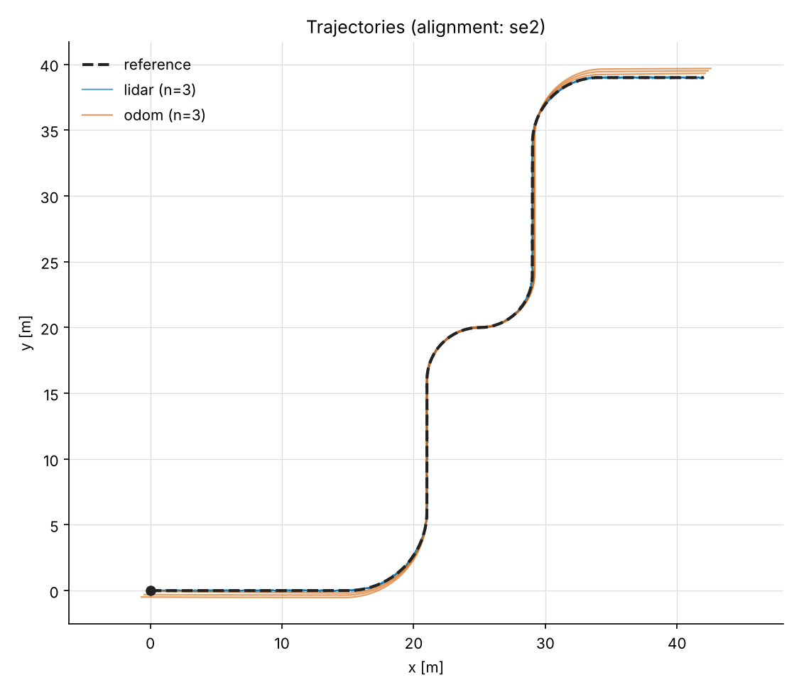
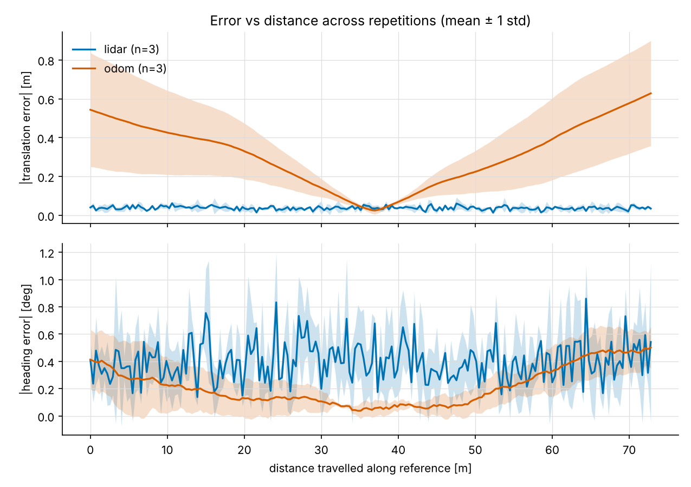
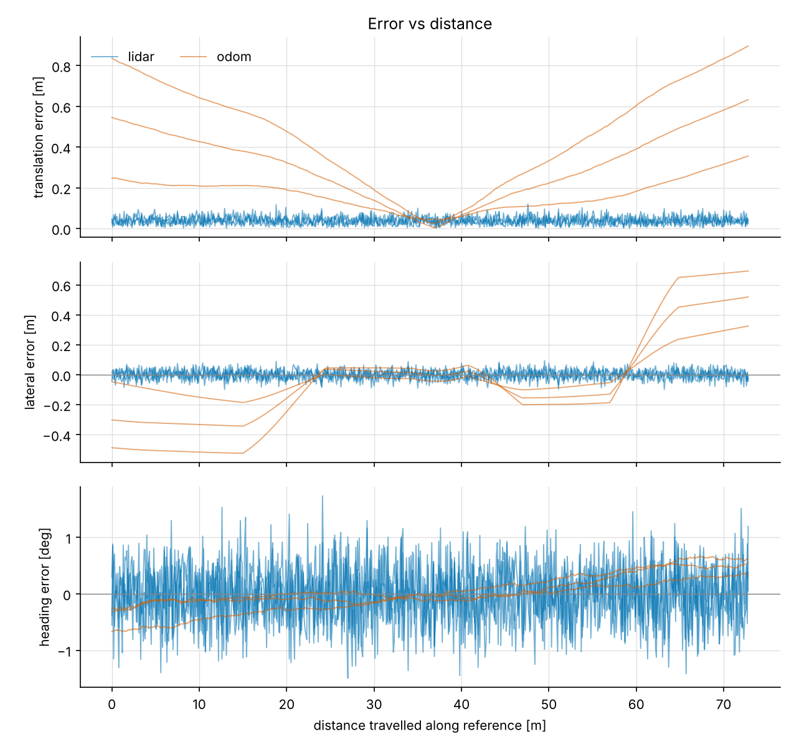

# trajeval

A generic Python tool for evaluating mobile-robot trajectories and SLAM datasets.
It compares one **reference** trajectory (a planned path or ground truth) with one or
more **estimates** (for example lidar SLAM and wheel odometry), aligns them, and reports
ATE, RPE and the errors that matter for ground robots: lateral, longitudinal and heading.

* Reads CSV (column names detected automatically), TUM and KITTI files.
* Associates samples by timestamp, or resamples by travelled distance when there are no timestamps.
* Aligns with SE(2), Sim(2), SE(3), Sim(3) (Umeyama, with or without scale), first-pose alignment, or no alignment.
* Aggregates repeated runs of the same mission (mean ± std across repetitions).
* Writes PNG figures, a canonical CSV of the aligned trajectories and a JSON file of metrics.

Dependencies: `numpy` and `matplotlib` only.



## Installation

```bash
cd trajeval
pip install .            # or: pip install -e ".[test]" for development
```

## Quick start

```bash
trajeval compare --ref ref.csv --est est1.csv est2.csv --align se2 --out results/
```

Try it on the bundled synthetic data (see [examples/](examples/)):

```bash
cd trajeval/examples
python generate_examples.py
trajeval compare --ref data/ground_truth.csv \
    --est "lidar=data/lidar_run*.txt" "odom=data/odom_run*.csv" \
    --align se2 --out results/
```

```
| estimate | reps | ATE rmse [m]    | lat rmse [m]    | head rmse [deg] | RPE t rmse [m]  | final [m]       |
|----------|------|-----------------|-----------------|-----------------|-----------------|-----------------|
| lidar    | 3    | 0.0431 ± 0.0010 | 0.0307 ± 0.0006 | 0.4934 ± 0.0085 | 0.0610 ± 0.0011 | 0.0345 ± 0.0102 |
| odom     | 3    | 0.3537 ± 0.1718 | 0.2502 ± 0.1182 | 0.2607 ± 0.1265 | 0.0204 ± 0.0099 | 0.6280 ± 0.2708 |
```

(Excerpt. The real table has more columns and one row per run as well.)

## Inputs

`trajeval` reads the format from each file's contents, not its extension:

| Layout | How it is recognised |
|---|---|
| CSV / whitespace table with a header | columns found by name, see below |
| TUM: `timestamp tx ty tz qx qy qz qw` | 8 numeric columns, optional `#` header |
| KITTI: 12 values of the 3×4 pose matrix per line | 12 numeric columns (13 = leading timestamp) |
| Headerless `x y` / `t x y` / `t x y yaw` | 2 / 3 / 4 numeric columns |

Recognised column names (case and separators ignored, units such as `[m]` stripped):

* time: `t`, `time`, `timestamp`, `stamp`, `%time`, `header.stamp`, `*_ns`, …
  Nanosecond, microsecond and millisecond epoch values are converted to seconds.
* position: `x`, `pos_x`, `position.x`, `px`, `tx`, `field.pose.pose.position.x`, `p_RS_R_x`, …
* orientation: quaternions `qx qy qz qw` (`orientation.x`, `q_RS_w`, …), or a planar
  `yaw`/`theta`/`heading` in radians (`yaw_deg`, `heading_deg` in degrees).

Files without orientation are accepted: the heading then comes from the path tangent.
Run `trajeval info FILE` to see how a file is parsed. If detection gets it wrong, override it
with `--columns "t,_,x,y,yaw"` (`_` skips a column) or `--format tum|kitti|csv`.

## Synchronisation

| `--sync` | Use when | What it does |
|---|---|---|
| `auto` (default) | always | `time` if both files have timestamps, `distance` otherwise |
| `time` | both timestamped | one-to-one nearest timestamps within `--max-dt` (default 0.02 s); `--time-offset` shifts the estimate |
| `interp` | dense ground truth | interpolates the reference (linear + SLERP) at every estimate timestamp |
| `distance` | no timestamps / planned path | resamples both on a common travelled-distance grid (`--step` in metres) |

In distance mode the estimate's travelled distance is normalised to the reference length by
default (`--distance-mode normalized`). This copes with scale errors, and the distance is
measured at the reference resolution, so dense noisy estimates do not inflate it. The two
trajectories should cover the same path from start to end. Use `--distance-mode absolute`
to compare metres travelled as they are.

## Alignment

`--align` chooses the transform fitted to the matched samples, `p_aligned = s·R·p_est + t`:

| method | DOF | typical use |
|---|---|---|
| `none` | 0 | estimate already in the reference frame |
| `origin` | 6 | match the first pose, to measure accumulated drift |
| `se2` (default) | 3 | ground robots: yaw + xy translation |
| `sim2` | 4 | `se2` + scale |
| `se3` | 6 | 3D SLAM / VIO |
| `sim3` | 7 | monocular VO (unknown scale) |

`--n-align N` fits the alignment on the first `N` matched poses only, so the remaining
drift stays visible. The fitted transform (rotation, translation, scale, yaw) is saved in
`metrics.json`.

## Metrics

After alignment, each matched pair gives the following errors:

* **ATE**: `‖p_est − p_ref‖` (3D) and `ate_xy` (planar).
* **Lateral / longitudinal**: the position error in the frame of the reference path.
  Longitudinal runs along the path tangent (positive = ahead); lateral runs along the
  left normal (positive = left of the path). Vertical error is reported separately.
* **Heading**: wrapped `yaw_est − yaw_ref`, in degrees.
* **RPE**: relative pose error over `--rpe-delta` metres of reference path
  (`--rpe-unit m`, default 1 m) or frames (`--rpe-unit frames`). Reported as translation
  (m and % of delta) and rotation (deg).
* **Final error** and **drift %** (final error / path length).

Each per-sample error is summarised by RMSE, mean, median, std, min, max and max |·|.

## Repetitions

Give estimates as `LABEL=PATH`. Estimates that share a label are repetitions of the same
mission. Quote glob patterns (`"lidar=runs/lidar_*.csv"`) and `trajeval` expands them
itself. Every scalar metric is then aggregated per label: mean, sample std, min, max and n.
Two figures summarise the repetitions: the mean ± std error versus distance, and bar charts
of the main metrics.

With one `--ref`, every repetition is compared against it. With several `--ref` files, the
i-th repetition of each label is compared with the i-th reference, for runs that each have
their own ground truth.



## Outputs

`--out DIR` receives:

| file | content |
|---|---|
| `metrics.json` | config, references, and for each estimate: sync info, alignment, metrics; plus `aggregate` per label |
| `aligned.csv` | canonical long-format CSV, one row per matched pair: `label, repetition, index, t, distance, ref_x…ref_yaw, est_x…est_yaw, err_translation, err_lateral, err_longitudinal, err_vertical, err_heading_deg` |
| `aligned_trajectories/<label>_rep<k>.csv` | the full aligned estimates (`t,x,y,z,qx,qy,qz,qw,yaw`), which `trajeval` can read back |
| `summary.md` | the summary table printed on screen |
| `trajectories.png` | top view: reference and aligned estimates |
| `error_vs_distance.png` | translation, lateral and heading error vs distance travelled |
| `error_vs_distance_repetitions.png` | mean ± std across repetitions (only when there are repetitions) |
| `metrics_summary.png` | bar charts of ATE / lateral / heading / RPE (mean ± std) |



## Python API

```python
from trajeval import EvalConfig, evaluate, evaluate_many, aggregate, read_trajectory
from trajeval.report import write_report

ref = read_trajectory("ground_truth.csv")
lidar = read_trajectory("lidar_run1.txt")

res = evaluate(ref, lidar, EvalConfig(align="se2", rpe_delta=2.0))
print(res.metrics["ate"]["rmse"], res.metrics["lateral"]["rmse"], res.alignment.yaw)

runs = [("lidar", read_trajectory(p)) for p in ["lidar_run1.txt", "lidar_run2.txt"]]
results = evaluate_many([ref], runs, EvalConfig(align="se2"))
print(aggregate(results)["lidar"]["metrics"]["ate.rmse"])   # mean / std / min / max / n
write_report(results, [ref], EvalConfig(align="se2"), "results/")
```

Lower-level building blocks: `trajeval.alignment.umeyama`, `trajeval.association.synchronize`,
`trajeval.metrics.compute_errors` / `rpe`, and `trajeval.synthetic` (line, arc and S-curve
generators, lateral offsets, noise).

## Tests

```bash
pip install -e ".[test]"
pytest
```

The tests use synthetic straight, curved and S-shaped trajectories with known transforms and
noise. They check that:

* alignment recovers the applied SE(2) / Sim(2) / SE(3) / Sim(3) transform;
* a constant lateral offset `d` gives lateral error `d` and ATE `|d|` on every shape;
* a heading bias is recovered exactly, and angles wrap correctly;
* a scale drift `k` gives RPE `k·Δ` over `Δ` metres and drift `100·k` %;
* Gaussian noise `σ` gives ATE RMSE ≈ `σ√2` (Rayleigh mean `σ√(π/2)`);
* timestamp association, interpolation and distance resampling (including dense, noisy,
  unevenly sampled and scaled estimates) reproduce the true correspondences;
* the readers handle TUM, KITTI, ROS and EuRoC CSVs and unit conversions, and the CLI
  writes every output.
